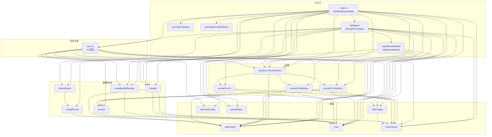

# 04 · 依赖关系

## 1. 运行时依赖（dependencies，package.json）

### 云存储 SDK

| 包 | 用途 | 使用处 |
|---|---|---|
| `@aws-sdk/client-s3` | S3 协议（PutObject/GetObject/ListObjectsV2/DeleteObject 等） | `remoteForS3.ts` |
| `@aws-sdk/lib-storage` | 大文件 multipart 分片上传（Upload 类） | `remoteForS3.ts` |
| `@aws-sdk/types` / `@smithy/fetch-http-handler` / `@smithy/protocol-http` / `@smithy/querystring-builder` | AWS SDK 底层：自定义 `ObsHttpHandler` 把 HTTP 层替换为 Obsidian `requestUrl` | `remoteForS3.ts:66` |
| `webdav` | WebDAV 客户端（PROPFIND/GET/PUT/MKCOL/DELETE） | `remoteForWebdav.ts` |
| `@microsoft/microsoft-graph-client` | OneDrive Graph API 客户端 | `remoteForOnedrive.ts` |

### 数据与算法

| 包 | 用途 | 使用处 |
|---|---|---|
| `localforage` | IndexedDB 封装，本地 7 张元数据表 | `localdb.ts` |
| `p-queue` | Promise 并发队列（同步执行引擎） | `sync.ts`（V3） |
| `@fyears/tsqueue` | 队列工具（目录遍历的 BFS 队列） | `obsFolderLister.ts`、`remoteForWebdav.ts` |
| `pako` | deflate/inflate（设置 URI 导入导出压缩） | `importExport.ts` |
| `nanoid` | 生成 vaultRandomID | `localdb.ts` |
| `fast-equals` | deepEqual（metadata 比较） | `metadataOnRemote.ts` |
| `aggregate-error` | 聚合多个同步错误一次性抛出 | `main.ts`、`sync.ts`、`remoteForS3.ts` |
| `rfc4648` | base32 / base64url 编解码（文件名加密输出、metadata 混淆、设置包装格式） | `encrypt.ts`、`metadataOnRemote.ts`、`configPersist.ts`、`misc.ts` |
| `mustache` | i18n 翻译变量渲染 | `i18n.ts` |
| `loglevel` | 日志分级 | `moreOnLog.ts` |
| `http-status-codes` | HTTP 状态码 → 短语（WebDAV 错误提示） | `remoteForWebdav.ts` |
| `mime-types` | Content-Type 推断 | `remoteForS3.ts` 上传路径 |
| `emoji-regex-xs` | emoji 判定（文件名处理） | `misc.ts` |
| `xregexp` | 声明于 dependencies，当前源码无直接引用（遗留依赖） | — |

### 安全版本覆盖（overrides，v26.2.1 起）

```json
"overrides": {
  "qs": "^6.16.0",
  "moment": "2.31.0"
}
```

- `moment` 强制提升至 2.31.0，消除 GHSA-4p3w-j4w9-5jqw 公告（`obsidian` 官方包将其精确固定在 2.29.4；实际产物不打包该库，源码使用 Obsidian 宿主提供的 moment）。
- 传递依赖 `brace-expansion` 三条版本线（1.1.21 / 2.1.7 / 5.0.12）升级消除 3 个 DoS 公告（仅存在于 eslint 开发链，不进产物，无需 override，由 lockfile 固定）。

### Node polyfill（浏览器环境垫片）

`package.json` 的 `browser` 字段 + esbuild `nodeCoreFallbackPlugin` 双保险：

| Node 内建 | 替代包 | 原因 |
|---|---|---|
| `crypto` | `crypto-browserify` | 部分传递依赖引用 Node crypto |
| `path` | `path-browserify` | 同上 |
| `stream` | `stream-browserify` | AWS SDK 传递依赖 |
| `buffer` | `buffer`（+ `esbuild.buffer-shim.js` inject） | 全局 `Buffer` |
| `assert` / `url` / `util` / `process` | `assert` / `url/` / `util` / `process/browser` | 同上 |
| `fs` / `http` / `https` / `os` / `vm` | **空模块**（esbuild empty-module 命名空间） | 仅被传递依赖引用，插件自身不使用 |

> fork 的设计目标：**加密完全走 `window.crypto.subtle`**，因此主路径不依赖 crypto-browserify；polyfill 只为满足 SDK 传递依赖。

## 2. 开发依赖（devDependencies）

| 包 | 用途 |
|---|---|
| `esbuild` ^0.28 | 打包 |
| `typescript` ^4.6 | 类型检查（`npx tsc --noEmit` 可用；无独立 typecheck script） |
| `eslint` ^9 + `@typescript-eslint/parser` + `eslint-plugin-obsidianmd` | 代码检查（含 Obsidian 官方插件规则，`eslint.config.mjs`；v26.2.1 清理死代码后为 0 errors / 0 warnings） |
| `prettier` ^2 | 格式化（`npm run format` 全仓库） |
| `@types/node` / `@types/lodash` / `@types/mime-types` / `@types/mustache` | 类型声明 |
| `@microsoft/microsoft-graph-types` | Graph API 类型 |

## 3. 内部模块依赖图



> 全部为实际 import 关系（依 v26.2.4 源码核对）。设计约束（源码注释明示）：`baseTypes.ts` 只放类型，避免循环依赖（文件头注释）；`RemoteClient` 与各 `remoteFor*` 之间用**引用传递**配置（remote.ts:29-31 注释），客户端可原地修改配置并经回调持久化。

## 4. 外部服务交互要点

| 服务 | 协议要点 | 环境要求 |
|---|---|---|
| S3 | `bypassCorsLocally: true`（默认）时经 `ObsHttpHandler` 走 Obsidian `requestUrl`，不受浏览器 CORS 限制；分页 ListObjectsV2；5MB 分片；`requestChecksumCalculation: "WHEN_REQUIRED"` + `retryMode: "adaptive"`/`maxAttempts: 10` | 关闭 bypass 后才需为 bucket 配置 CORS（见 `docs/s3_cors_configure.md`） |
| WebDAV | 标准 HTTP（PROPFIND/PUT/…），digest/basic；depth 需服务端支持 `infinity` 才能一次列全 | 上游/坚果云等不同 depth 行为见 `docs/services_connectable_or_not.md` 与 `presetRules.ts` |
| OneDrive | OAuth2+PKCE（回调 `obsidian://third-party-sync-onedrive`）、Graph API、delta 增量 | clientID/authority 构建期注入（`DEFAULT_ONEDRIVE_CLIENT_ID/AUTHORITY`） |

## 5. Obsidian API 版本门槛（baseTypes.ts:173-180）

| 能力 | 最低 API 版本 | 常量 | 当前使用处 |
|---|---|---|---|
| `stat` 返回文件夹类型 | 0.13.27 | `API_VER_STAT_FOLDER` | `localdb.ts`（文件夹重命名记录补 stat） |
| `requestUrl`（桌面/iOS） | 0.13.26 | `API_VER_REQURL` | 参与 `VALID_REQURL` 判定 |
| `requestUrl`（Android） | 0.14.6 | `API_VER_REQURL_ANDROID` | 同上 |
| 综合开关 | — | `VALID_REQURL` | 运行时判定：S3/WebDAV 设置项显隐、CORS 提示、digest 认证选项等 |

manifest 声明 `minAppVersion: 1.11.0`，`versions.json` 维护历史版本映射。
